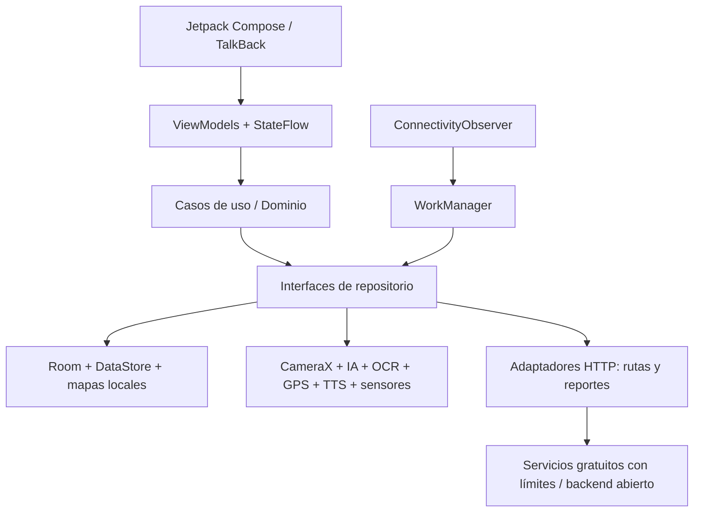

# Ruta Segura AI

> **Asistente móvil de percepción del entorno y navegación accesible, con enfoque offline-first.**
>
> Proyecto universitario de Soluciones Móviles · Android · Kotlin · Código y herramientas gratuitas · Documento base v1.0 · 20 de noviembre de 2026

[](#estado-del-proyecto) [](#pila-tecnol%C3%B3gica) [](#estrategia-onlineoffline)

> **Aviso de seguridad:** Ruta Segura AI es una herramienta *complementaria* de información y orientación. **No garantiza detectar peligros, elegir rutas seguras ni sustituye el bastón blanco, el perro guía o la formación en orientación y movilidad.** La ausencia de alertas **no significa** que el trayecto sea seguro. Las pruebas iniciales deberán realizarse en espacios controlados.

## Índice

1. [Presentación](#1-presentación)
2. [Problema, solución y propuesta de valor](#2-problema-solución-y-propuesta-de-valor)
3. [Objetivos y alcance](#3-objetivos-y-alcance)
4. [Principios y restricciones](#4-principios-y-restricciones)
5. [Usuarios y escenarios de uso](#5-usuarios-y-escenarios-de-uso)
6. [Módulos funcionales](#6-módulos-funcionales)
7. [Pila tecnológica](#7-pila-tecnológica)
8. [Servicios libres y gratuitos: decisión técnica](#8-servicios-libres-y-gratuitos-decisión-técnica)
9. [Arquitectura](#9-arquitectura)
10. [Estrategia online/offline](#10-estrategia-onlineoffline)
11. [Diseño de datos](#11-diseño-de-datos)
12. [Servicios Android y permisos](#12-servicios-android-y-permisos)
13. [Diseño accesible](#13-diseño-accesible)
14. [Visión artificial y métricas](#14-visión-artificial-y-métricas)
15. [Seguridad, privacidad y ética](#15-seguridad-privacidad-y-ética)
16. [Estructura del repositorio](#16-estructura-del-repositorio)
17. [Plan de desarrollo](#17-plan-de-desarrollo)
18. [Pruebas y criterios de aceptación](#18-pruebas-y-criterios-de-aceptación)
19. [Demostración para concurso](#19-demostración-para-concurso)
20. [Instalación y configuración](#20-instalación-y-configuración)
21. [Riesgos y decisiones pendientes](#21-riesgos-y-decisiones-pendientes)
22. [Licencias y atribuciones](#22-licencias-y-atribuciones)
23. [Referencias oficiales](#23-referencias-oficiales)

---

## 1. Presentación

**Nombre:** Ruta Segura AI  
**Subtítulo:** Asistente inteligente de percepción del entorno y navegación inclusiva.  
**Tipo:** Aplicación móvil Android.  
**Modalidad:** Proyecto universitario demostrable y ampliable.  
**Estado del proyecto:** Diseño y planificación; **no se declara implementada ninguna funcionalidad**.  
**Idioma inicial:** Español.  
**Región piloto propuesta:** zona urbana delimitada de Tacna, Perú (se seleccionará según disponibilidad de datos y condiciones para las pruebas).  
**Dispositivo del usuario:** únicamente un teléfono Android con cámara, altavoz, vibración y capacidades de ubicación compatibles.  
**Conectividad:** internet opcional para servicios online; funciones esenciales disponibles sin internet una vez instalados los modelos y recursos correspondientes.

### Visión

Crear una experiencia que permita escuchar información contextual sobre objetos observados por la cámara, leer textos, consultar ubicaciones, navegar por rutas y conocer reportes comunitarios de accesibilidad, sin depender permanentemente de un servidor.

### Diferenciador del proyecto

La innovación **a demostrar**, no asumida, combina cuatro áreas en una única aplicación: (1) percepción visual local, (2) interacción accesible por voz y vibración, (3) mapas y rutas con datos de barreras reportadas y (4) resiliencia offline-first. Se evaluará con métricas reales y pruebas con usuarios cuando sea apropiado.

## 2. Problema, solución y propuesta de valor

**Problema:** Las aplicaciones convencionales de navegación suelen disponer de información limitada sobre barreras de accesibilidad peatonal. Las tecnologías de visión pueden ayudar a describir el entorno, pero presentan errores, limitaciones de cobertura y dificultades de uso en condiciones reales.

**Solución:** Una app accesible que ofrece información auditiva y táctil sobre objetos reconocidos, funciones de lectura OCR, ubicación GPS, rutas peatonales y reportes colaborativos de accesibilidad, indicando claramente incertidumbre, restricciones de cobertura y disponibilidad de datos.

**Propuesta de valor:** un flujo continuo entre percepción local y navegación, con degradación controlada cuando falla la conectividad, sin equipos auxiliares ni pagos obligatorios durante el prototipado.

## 3. Objetivos y alcance

### Objetivo general

Diseñar, implementar y evaluar un prototipo Android de asistencia visual y navegación accesible que combine visión artificial local, servicios de geolocalización, información colaborativa de barreras y una arquitectura offline-first.

### Objetivos específicos

1. Implementar detección de categorías de objetos verificadas mediante cámara y modelo local.
2. Producir mensajes de voz y vibración accesibles, priorizados y sin repetición excesiva.
3. Integrar lectura OCR y síntesis de voz offline cuando exista voz local instalada.
4. Mostrar ubicación GPS y rutas peatonales mediante servicios cartográficos libres o gratuitos.
5. Guardar rutas, zonas y reportes para uso sin conexión cuando los datos estén disponibles legalmente.
6. Sincronizar reportes colaborativos con un backend de código abierto cuando haya conexión.
7. Medir precisión, latencia, consumo de batería, accesibilidad y usabilidad.

### Alcance del MVP (primera versión demostrable)

- Inicio accesible y configuración de permisos.
- CameraX + detector local de **personas, autos, bicicletas y motocicletas**, siempre que sean categorías realmente soportadas por el modelo seleccionado.
- Avisos por voz y vibración basados en clases y posición relativa en imagen (izquierda/centro/derecha).
- OCR offline de texto impreso y lectura en voz alta.
- GPS y mapa básico.
- Consulta online de una ruta peatonal; conservación local de la ruta consultada.
- Contacto de emergencia con SMS preparado y confirmación del usuario.
- Room, DataStore y estados de conexión.

### Fuera del MVP / investigación posterior

- Detección especializada de baches, escalones o huecos: requiere dataset, entrenamiento y evaluación real.
- Distancia exacta a obstáculos con cámara monocular: **no se promete**; necesita metodología y validación independientes.
- Cálculo de nuevas rutas offline: requiere motor y grafo peatonal local, no solo mapas descargados.
- Asistente conversacional en la nube, seguimiento familiar permanente, predicción de riesgo y puntuaciones de accesibilidad: opcionales, con controles éticos y técnicos.

## 4. Principios y restricciones

- **Un solo dispositivo:** el usuario no necesita accesorios externos. Se puede usar infraestructura online para servicios comunitarios.
- **Software sin costo de licencia:** priorizar proyectos de código abierto, SDK gratuitos y datos abiertos.
- **No confundir libre con gratuito:** una API gratuita puede tener cuotas, políticas o claves, y el alojamiento de servidores puede generar gastos.
- **Offline-first:** visión, OCR, ajustes y datos almacenados deben seguir funcionando sin internet.
- **Privacidad por defecto:** no grabar ni subir video o fotografías continuamente.
- **Accesibilidad desde el diseño:** probar con TalkBack, controles grandes, lenguaje claro y alternativas táctiles/auditivas.
- **Seguridad verificable:** no afirmar “camino despejado” o “ruta segura” basándose solo en el modelo.
- **Sin servicios pagados obligatorios:** cualquier proveedor online deberá poder sustituirse por otro o por una instalación autogestionada.
- **Sin claves secretas incrustadas:** evitar credenciales privadas en el APK; aplicar cuotas, restricciones y, cuando corresponda, un proxy o backend.

## 5. Usuarios y escenarios de uso

| Usuario | Necesidad | Flujo propuesto |
|---|---|---|
| Persona con discapacidad visual | Obtener información complementaria del entorno | Activar cámara → escuchar objetos y posiciones aproximadas |
| Persona que necesita leer un texto | Leer cartel o menú | Abrir lector → capturar → OCR → TTS |
| Usuario que navega a un destino | Consultar ruta e indicaciones | Elegir destino → obtener ruta → seguir instrucciones auditivas |
| Usuario sin internet | Mantener funciones principales | IA/OCR locales y consulta de recursos previamente guardados |
| Usuario que encuentra una barrera | Colaborar con la comunidad | Registrar tipo y ubicación → guardar → sincronizar |
| Usuario que necesita ayuda | Contactar a una persona de confianza | Pulsar SOS → confirmar → preparar SMS o llamada |

## 6. Módulos funcionales

| ID | Módulo | Prioridad | Estado offline esperado |
|---|---|---|---|
| M01 | Onboarding y accesibilidad | P0 | Completo |
| M02 | Permisos contextuales | P0 | Completo |
| M03 | Cámara y detector de objetos | P0 | Completo con modelo incluido |
| M04 | Motor de alertas (TTS + vibración) | P0 | Completo con voz offline disponible |
| M05 | OCR de documentos y carteles | P0 | Completo con modelo incluido |
| M06 | GPS y ubicación | P0 | Sujeto a señal y capacidades del teléfono |
| M07 | Búsqueda de lugares y rutas | P1 | Búsqueda/cálculo nuevos principalmente online |
| M08 | Mapas y rutas guardadas | P1 | Recursos previamente descargados |
| M09 | Reportes de barreras | P1 | Guardar localmente y sincronizar después |
| M10 | Contacto y SOS | P0 | Red telefónica necesaria para SMS/llamada |
| M11 | Comandos de voz | P2 | Solo si existe reconocedor local compatible |
| M12 | Historial y favoritos | P1 | Completo |
| M13 | Configuración y ahorro energético | P1 | Completo |
| M14 | Comparación experimental de rutas | P2 | Solo con datos suficientes y validados |
| M15 | Detector especializado de desniveles | Investigación | Solo tras entrenamiento y validación |

**Prioridades:** P0 = imprescindible para MVP; P1 = versión concurso; P2 = evolución; Investigación = no prometer sin pruebas.

## 7. Pila tecnológica

| Capa | Herramienta / tecnología | Modelo de costo / licencia | Motivo |
|---|---|---|---|
| Entorno | Android Studio + Gradle | Gratuito | Desarrollo y compilación |
| Lenguaje | Kotlin | Código abierto | Lenguaje principal |
| UI | Jetpack Compose + Material 3 | Bibliotecas gratuitas | Pantallas reactivas accesibles |
| Arquitectura | MVVM + Clean Architecture + Hilt | Gratuito | Separación y pruebas |
| Asincronía | Coroutines + StateFlow | Gratuito | Flujos y tareas concurrentes |
| Cámara | CameraX | Gratuito | Vista previa y análisis |
| IA local | LiteRT / TensorFlow Lite | Runtime gratuito; revisar licencia del modelo | Inferencia en el teléfono |
| OCR | ML Kit Text Recognition, variante *bundled* | SDK de uso gratuito; no es sinónimo de software completamente abierto | OCR sin depender de descarga en primer uso |
| Audio | Android TextToSpeech | API Android; voz depende del dispositivo | Síntesis de voz |
| Sensores | SensorManager / VibratorManager | APIs Android | Orientación y feedback |
| Ubicación | LocationManager | API Android | GPS sin requerir servicio Google externo |
| Mapas | MapLibre Native Android | Código abierto (BSD-2-Clause) | Visualización flexible de mapas |
| Datos geográficos | OpenStreetMap | Datos ODbL, con obligaciones de atribución | Red vial y puntos de interés |
| Rutas online | openrouteservice (ORS) | Motor abierto; API alojada con plan gratuito y cuotas | Rutas peatonales en prototipo |
| Alternativa de rutas propia | OSRM / openrouteservice autogestionado | Código abierto; **servidor no necesariamente gratuito** | Independencia del proveedor |
| Mapas offline | PMTiles + paquetes propios compatibles con MapLibre | Formato abierto; generación con Planetiler | Mapas locales obtenidos de fuentes permitidas |
| Persistencia | Room + DataStore | Gratuito | Datos offline |
| Red | Retrofit + OkHttp | Código abierto | APIs HTTP |
| Sincronización | WorkManager | Gratuito | Reintentos y trabajo diferido |
| Backend comunitario | PostgreSQL + PostGIS + FastAPI o Ktor | Código abierto; alojamiento por definir | Almacenamiento de reportes |
| Control de versiones | Git + GitHub repositorio público | Uso gratuito sujeto a plan | Seguimiento del código |
| Pruebas | JUnit + AndroidX Test + Espresso/Compose UI Test | Gratuito | Calidad funcional |

**Decisión técnica:** no se usará Firebase ni una API de IA de pago como dependencia principal. El backend de reportes es **opcional durante el MVP**; para una demo completa puede ejecutarse temporalmente en una computadora de desarrollo, pero el usuario final solo empleará su celular. Si se exige que no exista ningún servidor, el módulo colaborativo quedaría limitado a registros locales, sin comunidad en tiempo real.

## 8. Servicios libres y gratuitos: decisión técnica

### 8.1 Mapas y teselas

- **Visualizador:** MapLibre Native Android.
- **Datos:** OpenStreetMap, respetando atribución y ODbL.
- **Online:** usar un proveedor de mapas con política explícita para aplicaciones y consumo previsto; no asumir que un endpoint público es ilimitado.
- **Offline:** crear un paquete regional propio de datos OSM con Planetiler a formato PMTiles, verificar compatibilidad de MapLibre, atribución, licencia y almacenamiento. Se puede preparar el paquete durante el desarrollo y distribuirlo en la app o permitir su descarga desde un alojamiento autorizado.
- **Prohibido por diseño:** descargas masivas/offline desde `tile.openstreetmap.org` o el servidor público vectorial de OSM.

### 8.2 Rutas peatonales online

**Opción inicial:** openrouteservice, consultando su plan gratuito actual antes de registrar una clave y sin asumir cuotas estables. Definir interfaz `RoutingProvider` para no acoplar la app al proveedor. Para operación sin cuotas externas, evaluar instalación autogestionada de openrouteservice u OSRM (con posible costo de infraestructura).

**Advertencia:** las rutas peatonales generadas con datos OSM no garantizan accesibilidad ni ausencia de obstáculos.

### 8.3 Búsqueda de lugares

- **MVP:** destinos guardados, coordenadas y búsqueda manual; explorar geocodificación ofrecida por el proveedor de rutas bajo sus límites.
- **Nominatim público:** solo pruebas puntuales que cumplan sus políticas, sin autocompletado ni uso intensivo; no tratarlo como motor de búsqueda principal del producto. Alternativa escalable: instancia propia o proveedor gratuito cuya política lo permita.

### 8.4 Reportes comunitarios

**Opción abierta:** API propia con FastAPI (Python), PostgreSQL y PostGIS. En desarrollo se puede usar Docker local sin pagar licencias. Para que varios usuarios compartan reportes por internet hará falta un servidor accesible y un alojamiento; **gratuito no significa disponibilidad ilimitada**. La API deberá ser reemplazable y ofrecer publicación, consulta geográfica, moderación, versionado y borrado.

### 8.5 Inteligencia artificial

- Seleccionar un detector de objetos con clases conocidas, fuente y licencia verificadas; exportarlo a formato compatible con LiteRT.
- Incluir el modelo en `assets` para inferencia sin internet.
- No depender de endpoints comerciales de visión ni de generación de texto.
- Para OCR, elegir ML Kit bundled y comprobar licencias/condiciones de distribución; si se requiere pila estrictamente FOSS, evaluar Tesseract, comparando precisión y latencia.

### 8.6 Costos previstos (prototipo)

| Concepto | Meta | Condición |
|---|---|---|
| Herramientas de desarrollo | S/ 0 en licencias | Computadora y teléfono propios |
| IA local y OCR | S/ 0 en uso de API | Descarga inicial de SDK y modelos durante desarrollo |
| Mapas y rutas | S/ 0 dentro de un plan gratuito | Cuotas y uso permitido; sujeto a cambios |
| Backend local de pruebas | S/ 0 en licencias | Ejecutado en PC propia |
| Hosting público 24/7 | **No presupuestado como gratuito garantizado** | Se decidirá según usuarios y demanda |
| SMS/calls | **No garantizado S/ 0** | Depende de operador y plan móvil |
| Publicación en tiendas | No incluida | Se puede distribuir APK de prueba |

### 8.7 Registro de servicios externos

Antes de integrar una API, registrar `proveedor`, `URL base`, `términos`, `atribución`, `límites`, `clave`, `política de datos`, `alternativa offline`, `responsable` y `fecha de revisión` en `docs/servicios-externos.md`. **Nunca subir claves privadas a Git.**

## 9. Arquitectura

**Patrón:** Clean Architecture + MVVM + repositorios offline-first, organizada por funcionalidades.



### Contratos esenciales

- `ObjectDetector`: recibe fotograma y retorna detecciones con confianza y geometría.
- `AlertPolicy`: aplica filtros, prioridades y frecuencia; no equipara detección con peligro confirmado.
- `SpeechEngine`: controla TTS y estados de disponibilidad de voces locales.
- `LocationRepository`: entrega posición, precisión y antigüedad.
- `RoutingRepository`: online / guardado / indisponible.
- `MapRegionRepository`: gestiona zonas locales y metadatos de licencias.
- `AccessibilityReportRepository`: inserta localmente y sincroniza cuando procede.
- `EmergencyCoordinator`: solicita confirmación y delega acciones a aplicaciones del sistema.

### Comportamiento de la cámara

`CameraX ImageAnalysis` debe usar `STRATEGY_KEEP_ONLY_LATEST`; liberar cada `ImageProxy` correctamente; desacoplar inferencia del hilo principal; reducir frecuencia ante calor y consumo. La cámara se iniciará con la app visible y permisos válidos: no prometer uso continuo oculto en segundo plano.

## 10. Estrategia online/offline

| Función | Online | Offline | Mensaje si no está disponible |
|---|---|---|---|
| Detección de objetos | Inferencia local | Inferencia local | “No se puede analizar la cámara” |
| OCR | Modelo local | Modelo local | “No se reconoce el texto” |
| Voz | Voz instalada, opcional descarga previa | Voz local instalada | Alertas táctiles y pantalla |
| Posición | GNSS + proveedores disponibles | GNSS si hay recepción | “Ubicación no disponible” |
| Mapa | Teselas de proveedor autorizado | PMTiles regional preparado | “Mapa de esta zona no descargado” |
| Ruta | Solicitud a proveedor | Ruta previamente guardada; **sin recálculo garantizado** | “No se puede calcular una ruta nueva sin conexión” |
| Reportes | Consultar y publicar | Crear y consultar caché | “Reporte guardado; pendiente de sincronización” |
| SOS | SMS, llamada o compartir | SMS/llamada solo si hay red celular | “No se pudo confirmar el envío” |

### Sincronización

1. Guardar cada reporte primero en Room con UUID, fecha y estado `PENDING`.
2. Al recuperar internet, `WorkManager` envía pendientes con backoff e identificador idempotente.
3. API responde con ID y versión del servidor.
4. Marcar `SYNCED`, `RETRY` o `CONFLICT`; nunca borrar reporte local antes de confirmar.
5. Aplicar caducidad, moderación y posibilidad de revocar reportes.

## 11. Diseño de datos

| Entidad | Campos mínimos |
|---|---|
| `UserPreference` | id, idioma, velocidadVoz, modoAltoContraste, vibraciónActiva, consentimiento |
| `EmergencyContact` | id, nombre, número, preferido |
| `FavoritePlace` | id, nombre, latitud, longitud |
| `SavedRoute` | id, origen, destino, geometría, proveedor, fecha, advertencias |
| `MapRegion` | id, nombre, rutaArchivo, tamaño, versiónDatos, licencia |
| `AccessibilityReport` | uuid, categoría, latitud, longitud, descripción, fecha, estadoVerificación, syncStatus |
| `SyncOperation` | uuid, tipo, payload, intentos, siguienteIntento, estado |
| `ReadingHistory` | id, texto, fecha, optIn |
| `DetectionMetric` | id, clase, confianza, latenciaMs, fecha, sin imagen personal |

Preferir guardar métricas agregadas; historial de detecciones desactivado por defecto. No almacenar rutas personales ni ubicaciones históricas de forma indefinida.

## 12. Servicios Android y permisos

### Componentes técnicos

- **`NavigationForegroundService`**: solo durante navegación iniciada por el usuario; notificación visible, acciones Pausar/Finalizar y tipo de servicio correcto.
- **`CameraAnalysisController`**: componente ligado al ciclo de vida de la pantalla/sesión; no iniciar cámara en segundo plano de manera incompatible con Android.
- **`SpeechManager`**: cola, prioridades, silencios, `AudioFocus`, cancelación.
- **`SyncWorker`**: sincronización diferida bajo conectividad.
- **`ConnectivityObserver`**: red disponible y capacidad efectiva de conectarse.
- **`SensorController`**: sensores opcionales y estrategia de ahorro.
- **`EmergencyCoordinator`**: ubicación más reciente + confirmación + intent de SMS/llamada.

### Permisos previstos (mínimos y contextuales)

| Permiso o capacidad | Motivo |
|---|---|
| `CAMERA` | Análisis visual y OCR |
| `ACCESS_FINE_LOCATION` / `ACCESS_COARSE_LOCATION` | Navegación y ubicación |
| `INTERNET` / `ACCESS_NETWORK_STATE` | Mapas, rutas y sincronización |
| `VIBRATE` | Alertas táctiles |
| `FOREGROUND_SERVICE` + tipo específico | Navegación activa cuando corresponda |
| `POST_NOTIFICATIONS` | Notificaciones en versiones Android aplicables |
| Micrófono | Solo si se implementan comandos de voz |

**Evitar `SEND_SMS`** en el MVP: abrir la aplicación de mensajes con `ACTION_SENDTO` y dejar al usuario confirmar el envío. Evitar solicitar ubicación en segundo plano salvo que un caso de uso demostrado lo exija y cumpla políticas. Evaluar restricciones de foreground services de Android 14+ y versiones posteriores.

## 13. Diseño accesible

- Compatibilidad con TalkBack y orden de foco lógico.
- Botones grandes y áreas táctiles de al menos 48 dp, ajustables a pruebas con usuarios.
- Contraste elevado sin comunicar estado exclusivamente por color.
- Pantalla inicial con cuatro acciones principales: **Asistencia**, **Navegación**, **Leer texto**, **SOS**.
- Mensajes breves, voz configurable y controles para interrumpir/repetir.
- No imponer gestos personalizados que interfieran con TalkBack.
- Confirmaciones accesibles, señales auditivas y táctiles redundantes.
- Soporte para aumento de fuente, modo oscuro y pantallas de permisos comprensibles.

### Pantallas planificadas

`Splash` · `Onboarding` · `Permisos` · `Inicio` · `Asistencia visual` · `Lector OCR` · `Mapa y destino` · `Opciones de ruta` · `Navegación activa` · `Descargas offline` · `Reportar barrera` · `Favoritos` · `SOS` · `Historial` · `Ajustes` · `Privacidad y seguridad`.

## 14. Visión artificial y métricas

**Modelo inicial:** seleccionar un detector preentrenado compatible con Android y documentar nombre, versión, licencia, peso, clases, transformación de entrada y salida, limitaciones y conjunto de evaluación. No definir el modelo exacto hasta verificar los requisitos del teléfono objetivo.

### Reglas de inferencia

1. Obtener frame CameraX y convertir al formato de entrada del modelo.
2. Ejecutar inferencia local y filtrar detecciones por confianza calibrada.
3. Aplicar suavizado temporal y confirmar objetos en varios frames.
4. Dividir el encuadre en izquierda/centro/derecha según centro de la caja, **sin inferir distancia métrica**.
5. Emitir solo descripciones verificadas y controlar frecuencia de alertas.
6. Suspender/reducir análisis si la aplicación cambia de modo o el dispositivo se calienta.

### Indicadores de evaluación (metas iniciales, no resultados)

- Latencia: establecer y medir meta según teléfono real (por ejemplo, mediana < 300 ms por inferencia en el MVP, sujeta a viabilidad).
- Precisión/recall: reportar por clase y condiciones de iluminación.
- Falsos negativos: medir específicamente porque importan para la seguridad.
- Alertas repetidas por minuto y carga cognitiva.
- Consumo de batería en una sesión de duración fija.
- Funcionamiento sin internet y recuperación tras reconexión.
- Éxito de tareas accesibles con TalkBack y usuarios participantes.

**Nunca afirmar seguridad de una ruta a partir de la detección.** Ninguna inferencia de distancia exacta se incluirá sin método y evaluación independientes.

## 15. Seguridad, privacidad y ética

- Solicitar consentimiento informado para datos personales y pruebas con participantes.
- No transmitir fotogramas ni guardar fotografías de terceros por defecto.
- Tratar ubicación y contactos como datos sensibles; guardar lo mínimo, permitir borrado y configurar retención.
- Usar HTTPS, control de acceso, validación de entradas y límites de abuso en API de reportes.
- Moderar reportes falsos, duplicados o caducados antes de influir en la comparación de rutas.
- No publicar ubicaciones habituales vinculadas a identidades sin consentimiento.
- Separar claramente hechos detectados, datos reportados y estimaciones del sistema.
- Probar con escenarios simulados/controlados; obtener supervisión experta para cualquier prueba real de movilidad.
- Revisar legislación peruana aplicable sobre protección de datos personales antes de desplegar una comunidad pública.

## 16. Estructura del repositorio

```text
ruta-segura-ai/
├── README.md
├── LICENSE                         # Por definir antes de publicar
├── .gitignore
├── settings.gradle.kts
├── build.gradle.kts
├── gradle.properties
├── gradle/libs.versions.toml
├── app/
│   ├── build.gradle.kts
│   └── src/main/
│       ├── AndroidManifest.xml
│       ├── assets/models/            # Modelos con licencia registrada
│       ├── assets/maps/              # Paquete regional piloto (si cabe)
│       └── java/com/rutasegura/ai/
│           ├── RutaSeguraApplication.kt
│           ├── MainActivity.kt
│           ├── core/
│           │   ├── designsystem/
│           │   ├── navigation/
│           │   ├── accessibility/
│           │   ├── permissions/
│           │   ├── connectivity/
│           │   └── util/
│           ├── di/
│           ├── feature/
│           │   ├── onboarding/
│           │   ├── home/
│           │   ├── vision/
│           │   ├── ocr/
│           │   ├── navigation/
│           │   ├── maps/
│           │   ├── reports/
│           │   ├── emergency/
│           │   ├── favorites/
│           │   └── settings/
│           ├── domain/
│           │   ├── model/
│           │   ├── repository/
│           │   └── usecase/
│           └── data/
│               ├── local/
│               ├── remote/
│               ├── camera/
│               ├── ml/
│               ├── audio/
│               ├── location/
│               ├── sensor/
│               └── sync/
├── backend/                           # Opcional: API libre de reportes
│   ├── README.md
│   ├── api/
│   ├── migrations/
│   └── compose.yaml
├── models/                            # Fichas técnicas, no archivos grandes en Git
├── docs/
│   ├── requisitos.md
│   ├── arquitectura.md
│   ├── servicios-externos.md
│   ├── privacidad.md
│   ├── accesibilidad.md
│   ├── modelo-datos.md
│   ├── plan-pruebas.md
│   ├── decisiones/                     # ADRs
│   └── concurso/
├── scripts/                            # Preparación de mapas y datos
└── .github/workflows/                  # CI gratuita dentro de sus límites
```

> Esta es la estructura **propuesta**, no un repositorio ya implementado. Puede simplificarse durante el MVP; evitar módulos Gradle innecesarios hasta tener un beneficio comprobable.

## 17. Plan de desarrollo

| Fase | Entregable | Criterio de salida |
|---|---|---|
| 0. Descubrimiento | Requisitos, riesgos, elección de teléfono y modelo | Alcance y dispositivos definidos |
| 1. Base Android | Proyecto, Compose, Hilt, navegación y tema | APK compila y abre en celular |
| 2. Accesibilidad | Onboarding, permisos y pantalla inicial | Flujos principales utilizables con TalkBack |
| 3. IA visual | CameraX + modelo local | Detecciones reales y métricas visibles |
| 4. Audio y alertas | TTS + vibración + reglas | Avisos no repetitivos y controlables |
| 5. OCR | Lectura y TTS | Texto de prueba leído sin internet |
| 6. GPS y mapas | Ubicación + MapLibre | Ubicación y mapa visibles |
| 7. Rutas | Proveedor gratuito + guardado | Ruta consultada, narrada y reabierta offline |
| 8. Persistencia | Room + DataStore | Preferencias y datos persisten al reiniciar |
| 9. Reportes | Formulario local + cola + API opcional | Reporte pendiente sincroniza al volver internet |
| 10. SOS | Contacto y acciones confirmadas | SMS preparado con ubicación y manejo de fallos |
| 11. Offline avanzado | Región PMTiles + rutas guardadas | Demo sin red y recuperación sin pérdida |
| 12. Validación | Pruebas, evaluación y documentación | Resultados medidos, límites y demo repetible |

**Definición de terminado:** cada fase debe compilar, ejecutar en teléfono físico, tener pruebas mínimas, documentar permisos y mostrar un resultado real, no una maqueta.

## 18. Pruebas y criterios de aceptación

### Casos prioritarios

- [ ] Instalar APK en un teléfono Android físico compatible.
- [ ] Activar y detener cámara sin fugas ni bloqueo de UI.
- [ ] Detectar una persona real en entorno controlado usando el modelo local.
- [ ] Reproducir voz en español sin conexión, previa instalación de voz local.
- [ ] Reconocer y leer un cartel de prueba sin internet.
- [ ] Mostrar ubicación con precisión y hora de actualización.
- [ ] Consultar ruta online y abrir su geometría guardada offline.
- [ ] Crear reporte sin internet; sincronizarlo una única vez al reconectar.
- [ ] Preparar SMS con ubicación y confirmar manualmente envío.
- [ ] Navegar pantallas principales con TalkBack.
- [ ] Medir latencia del modelo y batería en el dispositivo real.
- [ ] Mostrar mensajes claros cuando no existan datos, señal o permiso.
- [ ] Verificar atribuciones cartográficas y licencias de modelos.

### Pruebas no funcionales

Accesibilidad, privacidad, manejo de permisos denegados, seguridad de API, consumo energético, memoria, estabilidad, reconexión, pruebas de regresión y resistencia a entradas inválidas.

## 19. Demostración para concurso

**Guion tentativo de cinco minutos (en entorno controlado):**

1. **Problema (40 s):** explicar límites de las herramientas convencionales y riesgos de barreras peatonales.
2. **Visión (60 s):** reconocer objetos frente a cámara; escuchar clase y dirección, sin afirmar distancia exacta.
3. **OCR (40 s):** leer un cartel impreso desde el teléfono.
4. **Navegación (60 s):** seleccionar un destino, consultar una ruta y mostrar un reporte de barrera.
5. **Resiliencia (60 s):** quitar internet; repetir IA/OCR, abrir ruta/mapa guardado, crear reporte; reconectar y sincronizar.
6. **Cierre (40 s):** presentar métricas reales, límites, accesibilidad y siguiente etapa.

**Evidencias para jurado:** APK funcional, código fuente, diagramas, licencia, dataset de evaluación permitido, registro de pruebas, tabla de resultados medidos y video de respaldo (sin simular inferencias).

## 20. Instalación y configuración

> **Estado actual: planificación.** Los pasos siguientes se completarán cuando exista el proyecto compilable.

### Requisitos previstos

- Computadora con Android Studio y JDK compatible con la versión de Android Gradle Plugin elegida.
- Teléfono físico Android, preferiblemente con cámara posterior, sensor de ubicación y memoria suficiente.
- Cable USB o depuración inalámbrica.
- Internet durante instalación de dependencias, preparación de mapas y registro del proveedor gratuito de rutas.

### Primer arranque esperado

1. Clonar el repositorio cuando exista.
2. Abrir carpeta raíz en Android Studio.
3. Sincronizar Gradle.
4. Seleccionar dispositivo Android físico.
5. Ejecutar la app y conceder permisos por funcionalidad.
6. Verificar disponibilidad de voz local y modelos incluidos.
7. Configurar proveedor de rutas mediante configuración segura que no publique secretos.

### Configuración de API

Documentar un archivo de ejemplo como `local.properties.example` (sin credenciales), restricciones del token si las admite el proveedor y manejo de cuota agotada. **No incluir claves privadas reales en el repositorio ni confiar en que una clave del APK sea secreta.**

## 21. Riesgos y decisiones pendientes

| Riesgo o decisión | Mitigación / acción |
|---|---|
| Modelo de teléfono desconocido | Definir dispositivo objetivo antes de fijar tamaño de IA y rendimiento |
| Errores de detección | Informar incertidumbre; pruebas controladas, recall y falsos negativos |
| Rutas OSM incompletas | Mostrar procedencia, fecha y ausencia de garantía de accesibilidad |
| Proveedor gratuito agota cuotas | Caché, degradación offline y proveedor intercambiable |
| Mapa offline demasiado grande | Región piloto acotada, compresión y descarga con consentimiento |
| Confusión mapa offline vs rutas offline | Separar visualización, seguimiento y nuevo cálculo de rutas |
| Servidor comunitario no disponible | Guardar reportes localmente y sincronizar luego |
| Reportes incorrectos | Moderación, estado de verificación y caducidad |
| Voz offline ausente | Comprobación inicial y guía de instalación previa |
| Restricciones Android en segundo plano | Servicio de navegación correcto; cámara vinculada a sesión visible |
| GPS impreciso | Mostrar precisión/antigüedad y evitar indicaciones concluyentes |
| Privacidad de ubicación | Consentimiento, mínima retención y eliminación de datos |

### Decisiones por cerrar (ADR)

- **ADR-001:** versión mínima Android y teléfono de referencia.
- **ADR-002:** detector de objetos, clases y licencia.
- **ADR-003:** proveedor de teselas online autorizado.
- **ADR-004:** servicio de rutas y límites de cuenta gratuita.
- **ADR-005:** formato, procedencia y distribución de mapa regional PMTiles.
- **ADR-006:** proveedor/estrategia de geocodificación.
- **ADR-007:** implementación del backend colaborativo y alojamiento de la demo.
- **ADR-008:** licencia definitiva del código y política de contribuciones.

## 22. Licencias y atribuciones

- **Código del proyecto:** licencia de código abierto por decidir (por ejemplo, Apache-2.0 o MIT); no atribuir licencia definitiva sin elección.
- **OpenStreetMap:** © colaboradores de OpenStreetMap, datos bajo ODbL. Atribución visible donde corresponda y cumplimiento de obligaciones para obras derivadas.
- **MapLibre:** revisar licencia BSD-2-Clause y avisos de dependencias.
- **Modelos IA:** registrar licencia específica y restricciones de uso/distribución; no asumir que todo modelo “gratuito” es redistribuible.
- **Paquetes cartográficos:** registrar origen, fecha, transformaciones, cobertura y permisos de redistribución.
- **APIs:** respetar términos de uso, cuotas y reglas de atribución de cada proveedor.

## 23. Referencias oficiales

- [Android Developers](https://developer.android.com/)
- [CameraX](https://developer.android.com/media/camera/camerax)
- [Guía de arquitectura Android](https://developer.android.com/topic/architecture)
- [Trabajo offline-first](https://developer.android.com/topic/architecture/data-layer/offline-first)
- [WorkManager](https://developer.android.com/topic/libraries/architecture/workmanager)
- [Restricciones de servicios en primer plano](https://developer.android.com/develop/background-work/services/fgs/restrictions-bg-start)
- [ML Kit](https://developers.google.com/ml-kit)
- [Modelos empaquetados ML Kit](https://developers.google.com/ml-kit/tips/installation-paths)
- [LiteRT](https://ai.google.dev/edge/litert)
- [MapLibre Native](https://maplibre.org/projects/native/)
- [Ejemplos PMTiles en MapLibre Android](https://maplibre.org/maplibre-native/android/examples/data/PMTiles/)
- [OpenStreetMap y licencia](https://www.openstreetmap.org/copyright)
- [Política de teselas OpenStreetMap](https://operations.osmfoundation.org/policies/tiles/)
- [Política de teselas vectoriales OpenStreetMap](https://operations.osmfoundation.org/policies/vector/)
- [Política Nominatim](https://operations.osmfoundation.org/policies/nominatim/)
- [Planes openrouteservice](https://openrouteservice.org/plans/)
- [Código de openrouteservice](https://github.com/GIScience/openrouteservice)
- [OSRM](https://github.com/Project-OSRM/osrm-backend)
- [Planetiler](https://github.com/onthegomap/planetiler)
- [PostGIS](https://postgis.net/)

---

## Próximo hito

**Fase 0 → Fase 1:** confirmar teléfono de pruebas y SDK mínimo, seleccionar modelo con licencia verificable y proveedor cartográfico, crear el proyecto Android Studio y conseguir el primer APK compilable con pantalla de inicio accesible.

**Principio rector:** entregar una aplicación real, medible y honesta acerca de sus límites. El resultado del concurso dependerá de la calidad de la implementación, la evaluación y la presentación, no del número de funciones prometidas.


---

## Normativa documental EPIS FD01–FD06

**Regla obligatoria del proyecto:** requisitos, diseños, código y documentación avanzan a la par. Consulte [Gobierno documental y trazabilidad](docs/EPIS/00-GOBERNANZA-Y-TRAZABILIDAD.md). Las bases Markdown se encuentran en `docs/EPIS/` y deberán trasladarse a las plantillas Word oficiales conservando su presentación.

| Documento | Archivo de trabajo | Propósito |
|---|---|---|
| FD01 | [Abrir](docs/EPIS/FD01-Informe-Factibilidad.md) | Informe de Factibilidad |
| FD02 | [Abrir](docs/EPIS/FD02-Documento-Vision.md) | Documento de Visión |
| FD03 | [Abrir](docs/EPIS/FD03-Especificacion-Requerimientos-SRS.md) | Especificación de Requerimientos de Software (SRS) |
| FD04 | [Abrir](docs/EPIS/FD04-Documento-Arquitectura-SAD.md) | Documento de Arquitectura de Software (SAD) |
| FD05 | [Abrir](docs/EPIS/FD05-Informe-Proyecto-Final.md) | Informe de Proyecto Final |
| FD06 | [Abrir](docs/EPIS/FD06-Propuesta-Proyecto.md) | Propuesta del Proyecto |

**Nota:** El FD03 aportado como referencia describe otro sistema; no se reutilizan sus hechos, datos, autores ni resultados para Ruta Segura AI.
